# Mobility+ — Acessibilidade Inclusiva: Mobilidade sem Barreiras

## Sobre o projeto

O **Mobility+** é um aplicativo de acessibilidade, com o objetivo de contribuir para uma mobilidade urbana mais inclusiva por meio da tecnologia. A aplicação permite cadastrar e consultar estabelecimentos, visualizar informações sobre seus recursos de acessibilidade e registrar preferências relacionadas às necessidades dos usuários.

A proposta é facilitar o acesso a informações que auxiliem pessoas com deficiência ou mobilidade reduzida a identificar características dos locais antes de visitá-los.

## Problema identificado

A falta de informações sobre acessibilidade em estabelecimentos e espaços urbanos representa uma barreira para a autonomia e a mobilidade de muitas pessoas. Nem sempre é possível saber antecipadamente se um local possui rampa de acesso, piso tátil ou recursos de sinalização sonora e visual. Além disso, a acessibilidade não deve ser tratada como uma característica única. Um estabelecimento pode possuir rampa, mas não oferecer piso tátil, por exemplo. Por isso, é importante apresentar os recursos individualmente, permitindo que cada pessoa avalie quais características atendem às suas necessidades.

## Público beneficiado

O Mobility+ é direcionado principalmente a:

- Pessoas com deficiência física;
- Pessoas com deficiência visual;
- Pessoas com deficiência auditiva;
- Pessoas com deficiência intelectual;
- Pessoas com mobilidade reduzida;
- Usuários de cadeira de rodas, bengalas ou muletas;
- Pessoas interessadas em consultar informações sobre acessibilidade.

## Solução proposta

O Mobility+ propõe uma aplicação mobile para cadastrar, consultar e visualizar informações sobre estabelecimentos e suas características de acessibilidade.

Por meio do aplicativo, o usuário pode consultar os locais cadastrados, pesquisar estabelecimentos, utilizar filtros e visualizar detalhes sobre os recursos disponíveis.

A aplicação também apresenta um perfil de acessibilidade, no qual o usuário pode selecionar características relacionadas às suas necessidades.

Dessa forma, a solução busca facilitar o acesso à informação e contribuir para escolhas mais conscientes e uma maior autonomia na mobilidade urbana.

## Objetivos de Desenvolvimento Sustentável (ODS)

O projeto está relacionado aos Objetivos de Desenvolvimento Sustentável estabelecidos pela Organização das Nações Unidas (ONU), especialmente:

### ODS 10 — Redução das Desigualdades

O ODS 10 busca reduzir as desigualdades e promover a inclusão social. O Mobility+ relaciona-se a esse objetivo ao facilitar o acesso a informações sobre acessibilidade, contribuindo para que pessoas com diferentes necessidades possam tomar decisões mais conscientes sobre os espaços que desejam frequentar.

### ODS 11 — Cidades e Comunidades Sustentáveis

O ODS 11 busca tornar as cidades e os assentamentos humanos mais inclusivos, seguros, resilientes e sustentáveis. O projeto contribui para essa proposta ao incentivar a identificação e a divulgação de características de acessibilidade nos estabelecimentos urbanos.

## Funcionalidades

**Tela inicial:** apresenta o nome do aplicativo, sua proposta e os principais caminhos de navegação.

**Cadastro de estabelecimentos:** permite registrar nome, endereço, descrição e características de acessibilidade dos locais. Nome e endereço são campos obrigatórios e o formulário impede o registro quando estão vazios.

**Consulta de locais:** apresenta os estabelecimentos cadastrados para consulta, com mensagem indicativa quando não há registros.

**Pesquisa e filtros:** permite pesquisar estabelecimentos e filtrar os resultados por características de acessibilidade e favoritos.

**Detalhes do estabelecimento:** apresenta informações do local selecionado e seus recursos de acessibilidade.

**Ações sobre os registros:** disponibiliza opções de edição, exclusão (com confirmação) e marcação de favoritos.

**Mensagens de confirmação:** a interface exibe uma mensagem (Snackbar) ao cadastrar, editar, excluir e favoritar ou desfavoritar um estabelecimento.

**Perfil de acessibilidade:** permite selecionar características relacionadas às necessidades do usuário, como tipos de deficiência, uso de dispositivos de apoio e mobilidade reduzida.

## Recursos de acessibilidade considerados

| Recurso | Finalidade |
|---|---|
| Rampa de acesso | Facilitar o acesso físico aos estabelecimentos |
| Piso tátil | Auxiliar na orientação e mobilidade |
| Sinalização sonora | Oferecer informações por áudio |
| Sinalização visual | Facilitar a comunicação e orientação visual |

A proposta é apresentar cada recurso individualmente, reconhecendo que as necessidades de acessibilidade variam de pessoa para pessoa.

## Tecnologias utilizadas

- **Kotlin:** linguagem de programação utilizada no desenvolvimento;
- **Android Studio:** ambiente de desenvolvimento;
- **Jetpack Compose:** construção das interfaces;
- **Material Design 3:** componentes e padrões visuais;
- **Navigation Compose:** navegação entre as telas;
- **Room Database:** persistência local dos registros;
- **ViewModel:** gerenciamento do estado da aplicação;
- **Repository:** organização do acesso aos dados;
- **Kotlin Coroutines:** execução de operações assíncronas;
- **Kotlin Flow:** observação e atualização dos dados.

## Organização do projeto

O projeto foi organizado em camadas, buscando separar as responsabilidades da interface, dos dados e da lógica de apresentação.

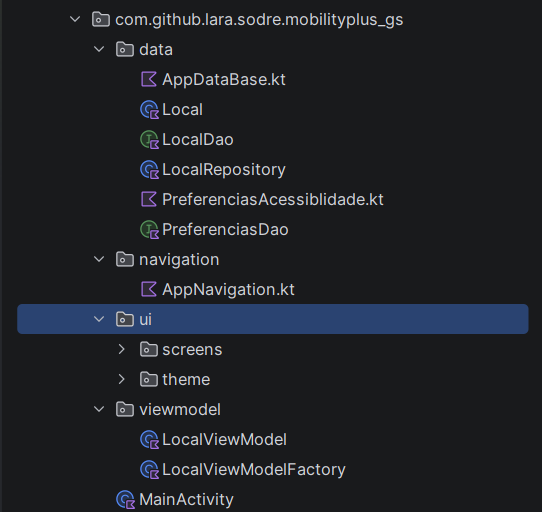

[**Abrir imagem da organização do projeto**](docs/screenshots/organizacao-projeto.png)

- **data:** entidades (`Local`, `PreferenciasAcessibilidade`), DAOs, banco Room (`AppDatabase`) e `LocalRepository`;
- **navigation:** rotas e navegação entre as telas (`AppNavigation`);
- **ui/screens:** telas em Jetpack Compose (início, locais, cadastro/edição, detalhes e perfil);
- **ui/theme:** cores, tipografia e tema do aplicativo;
- **viewmodel:** `LocalViewModel` e sua factory, responsáveis pelo estado e pelas ações da interface.

## Persistência de dados

O aplicativo utiliza Room Database para armazenar localmente os estabelecimentos cadastrados e as preferências de acessibilidade do usuário.

A organização da persistência utiliza:

- **Entity:** representa os dados dos estabelecimentos;
- **DAO:** define as operações de acesso ao banco de dados;
- **Database:** configura o banco de dados Room;
- **Repository:** centraliza o acesso aos dados;
- **ViewModel:** disponibiliza os dados para a interface.

A utilização do Room permite armazenar os registros no dispositivo, sem exigir um backend próprio ou sincronização em nuvem.

## Identidade visual

A identidade visual do Mobility+ segue uma proposta moderna, minimalista e intuitiva.

A interface utiliza tons de azul, branco e cinza claro, buscando transmitir confiança, clareza, tecnologia e acolhimento.

A organização visual prioriza a legibilidade, a navegação simples e a apresentação objetiva das informações.

---

## Telas do aplicativo

As capturas a seguir foram feitas com o aplicativo em execução e estão apresentadas na ordem do fluxo de utilização, desde a tela inicial até o cadastro, a edição, a exclusão e as preferências de acessibilidade.

> Os estabelecimentos exibidos nas capturas de tela (como "Biblioteca Central") são **dados fictícios de exemplo**, criados apenas para demonstrar o protótipo. O aplicativo não está integrado a nenhum serviço público ou externo.

### 1. Tela inicial

A tela inicial apresenta o nome e a proposta do Mobility+, além de disponibilizar acesso às principais funcionalidades do aplicativo: explorar locais, cadastrar estabelecimento e acessar o perfil de acessibilidade.

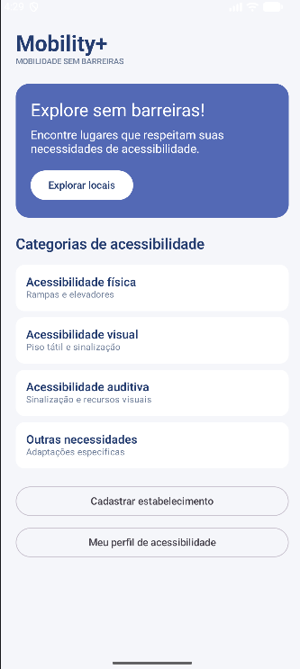

[**Abrir imagem da tela inicial**](docs/screenshots/tela-inicial.png)

### 2. Lista de locais

A tela apresenta os estabelecimentos cadastrados, permitindo consultar os registros e utilizar os recursos de pesquisa e filtragem (física, visual, auditiva e favoritos). Quando não há registros, o aplicativo exibe uma mensagem indicando que nenhum estabelecimento foi cadastrado.

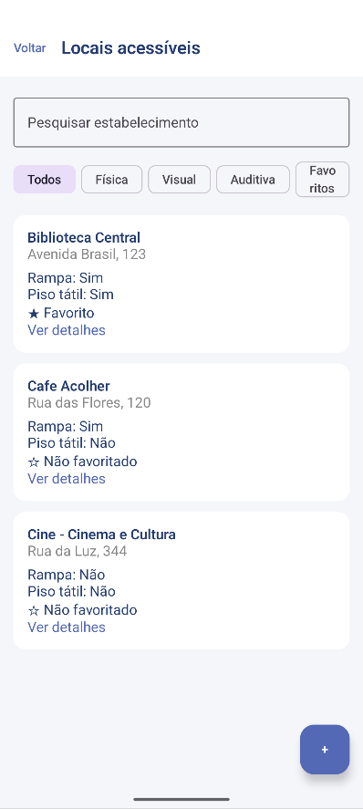

[**Abrir imagem da lista de locais**](docs/screenshots/locais-acessiveis.png)

### 3. Cadastro de estabelecimento

O formulário permite cadastrar um estabelecimento, informando nome, endereço, descrição e características de acessibilidade, como rampa, piso tátil e sinalizações. Nome e endereço são obrigatórios: se estiverem vazios, o aplicativo exibe um aviso e não registra o estabelecimento.

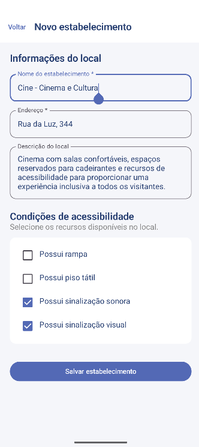

[**Abrir imagem do cadastro de estabelecimento**](docs/screenshots/cadastro-estabelecimento.png)

### 4. Mensagem de cadastro realizado

Após salvar, o aplicativo retorna para a tela anterior e exibe uma mensagem confirmando que o estabelecimento foi cadastrado.

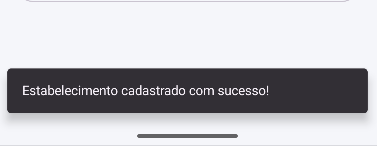

[**Abrir imagem da mensagem de cadastro**](docs/screenshots/mensagem-estabelecimento-cadastrado.png)

### 5. Detalhes do estabelecimento

Na tela de detalhes, o usuário pode consultar as informações do estabelecimento selecionado e visualizar os recursos de acessibilidade informados no cadastro. Nesta tela também estão as ações sobre o registro: favoritar, editar e excluir.

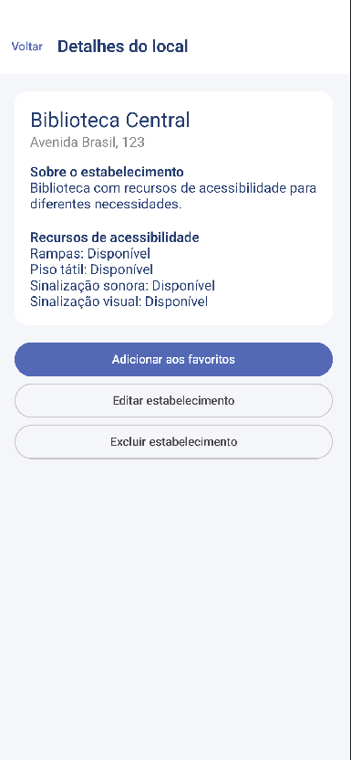

[**Abrir imagem dos detalhes do estabelecimento**](docs/screenshots/detalhes-local.png)

### 6. Edição de estabelecimento

Ao escolher a opção de editar, o formulário é aberto com os dados já preenchidos, permitindo alterar as informações e os recursos de acessibilidade do local.

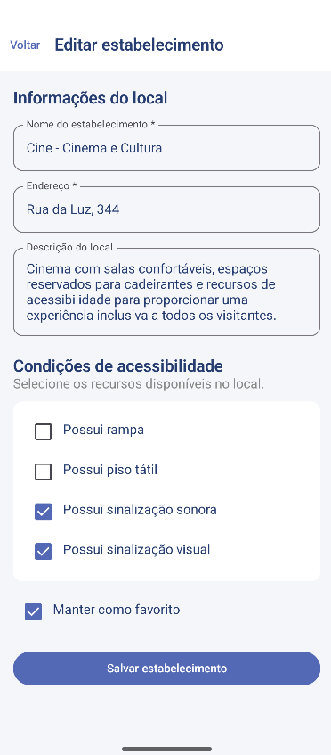

[**Abrir imagem da edição de estabelecimento**](docs/screenshots/editar-estabelecimento.png)

### 7. Mensagem de atualização

Ao salvar a edição, o aplicativo exibe uma mensagem confirmando que o estabelecimento foi atualizado, e a lista passa a refletir as alterações.

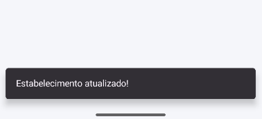

[**Abrir imagem da mensagem de atualização**](docs/screenshots/mensagem-atualizacao.png)

### 8. Exclusão de estabelecimento

Antes de excluir, o aplicativo solicita confirmação do usuário por meio de uma caixa de diálogo, evitando a remoção acidental do registro.

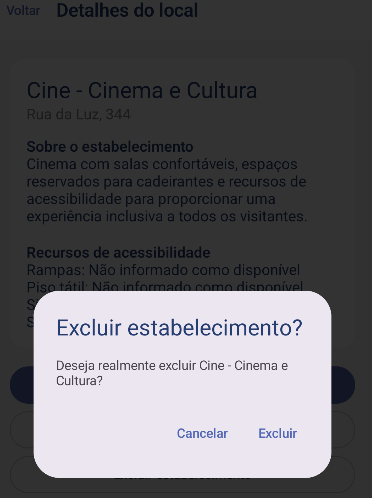

[**Abrir imagem da confirmação de exclusão](docs/screenshots/excluir-estabelecimento.png)

### 9. Mensagem de exclusão

Após confirmar, o estabelecimento é removido do banco de dados e o aplicativo exibe uma mensagem informando que a exclusão foi realizada.

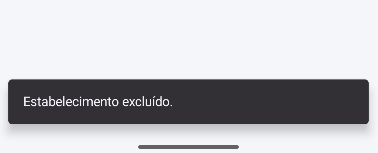

[**Abrir imagem da mensagem de exclusão**](docs/screenshots/mensagem-exclusao.png)

### 10. Perfil de acessibilidade

O perfil permite selecionar características relacionadas às necessidades e condições de mobilidade do usuário, como tipos de deficiência, uso de cadeira de rodas, bengala ou muletas e mobilidade reduzida.

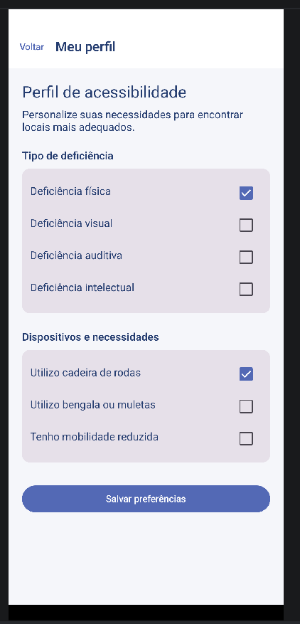

[**Abrir imagem do perfil de acessibilidade**](docs/screenshots/perfil-acessibilidade.png)

### 11. Confirmação das preferências

Após selecionar as opções desejadas, o usuário pode acionar a opção de salvar preferências. A interface apresenta uma mensagem de confirmação da ação, e as preferências ficam armazenadas no Room.

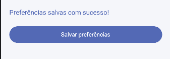

[**Abrir imagem da confirmação das preferências**](docs/screenshots/mensagem-preferencias-salvas.png)

## Fluxo principal de utilização

O fluxo principal do Mobility+ foi organizado para permitir uma navegação simples entre as funcionalidades:

1. O usuário acessa a tela inicial do aplicativo.
2. Seleciona a opção de cadastrar um estabelecimento (ou acessa a lista de locais e utiliza o botão "+").
3. Preenche as informações do local e seleciona os recursos de acessibilidade disponíveis.
4. Ao salvar, o aplicativo exibe uma mensagem de confirmação e o estabelecimento passa a constar na listagem de locais.
5. O usuário pode pesquisar, utilizar filtros e selecionar um estabelecimento para consultar seus detalhes.
6. Na tela de detalhes, pode favoritar o local, editá-lo ou excluí-lo (com confirmação), e a cada ação o aplicativo exibe uma mensagem.
7. Os dados são armazenados no Room e permanecem disponíveis ao fechar e reabrir o aplicativo.
8. No perfil de acessibilidade, pode selecionar suas características e preferências e salvá-las.

Esse fluxo demonstra a proposta central do aplicativo: facilitar o registro e a consulta de informações relevantes sobre acessibilidade.

## Evidências de funcionamento

Esta seção reúne as evidências do ciclo completo: criação de um registro, ação adicional sobre ele e permanência dos dados após reabrir o aplicativo.

### 1. Criação de um registro

O estabelecimento é preenchido no formulário de cadastro e, ao salvar, o aplicativo confirma o registro e o exibe na listagem.

### 2. Ações adicionais sobre o registro

Foram implementadas as ações de **editar**, **excluir** (com confirmação) e **favoritar**. As imagens abaixo mostram a edição e a exclusão, cada uma acompanhada da mensagem de confirmação.

### 3. Persistência após reabrir o aplicativo

O aplicativo foi fechado completamente (removido dos aplicativos recentes) e aberto novamente. Os registros cadastrados e as alterações realizadas continuam salvos, demonstrando a persistência dos dados por meio do Room Database.

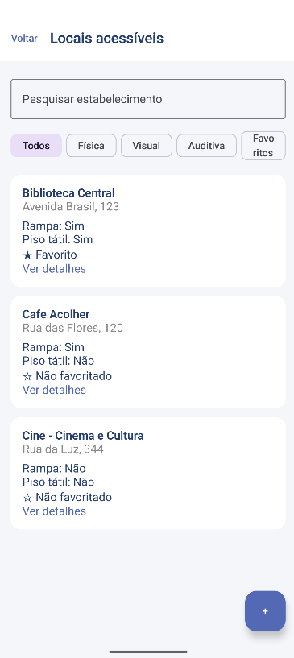

[**Abrir imagem da comprovação dos registros e alterações**](docs/screenshots/comprovacao-registros-alterados.png)

## Como executar o projeto

Para executar o Mobility+ em ambiente local:

1. Clone ou baixe o repositório.
2. Abra o projeto no Android Studio.
3. Aguarde a sincronização do Gradle.
4. Inicie um emulador Android ou conecte um dispositivo compatível.
5. Execute o aplicativo utilizando o botão **Run**.

**Requisitos:** Android Studio, Android SDK e ambiente de execução Android compatível com a configuração do projeto.

## Considerações finais

O Mobility+ utiliza a tecnologia como ferramenta de apoio à inclusão e à mobilidade urbana.

A aplicação busca facilitar o acesso a informações sobre acessibilidade, valorizando as diferentes necessidades dos usuários e contribuindo para uma sociedade com menos barreiras.

O projeto demonstra como uma solução mobile pode apoiar iniciativas CitizenTech, aproximando a tecnologia de necessidades reais da população.

---

## Integrantes

- **Nome:** Beatriz Matos Marques Rosa — **RM:** 554805
- **Nome:** Keyla Dayana Magne Ala — **RM:** 557630
- **Nome:** Lara Rosa Sodré — **RM:** 5555496